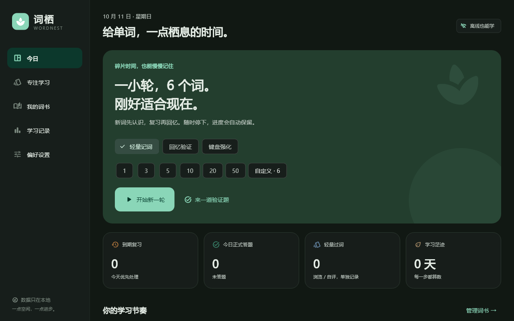
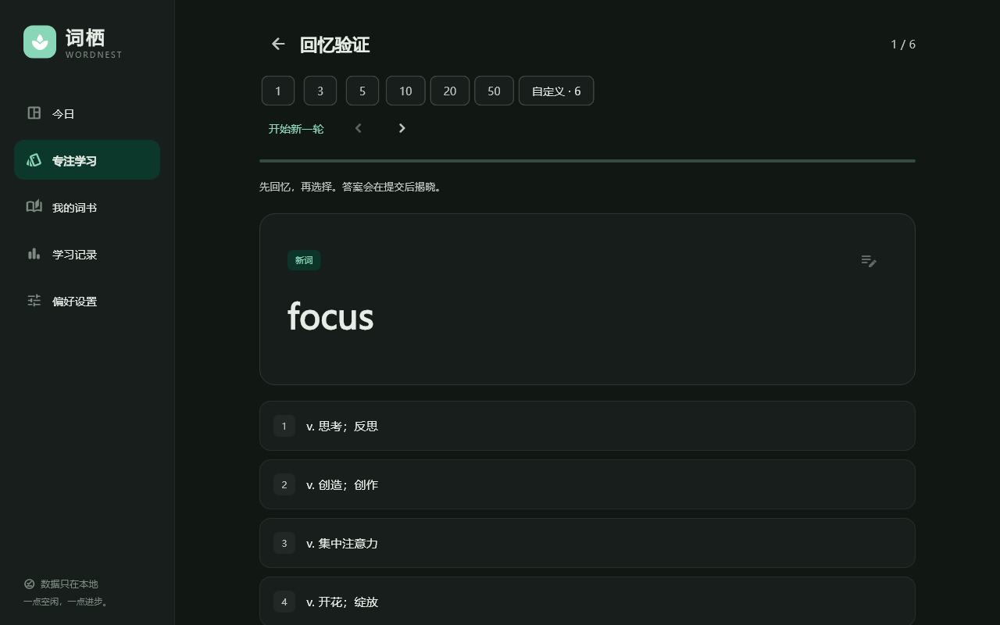
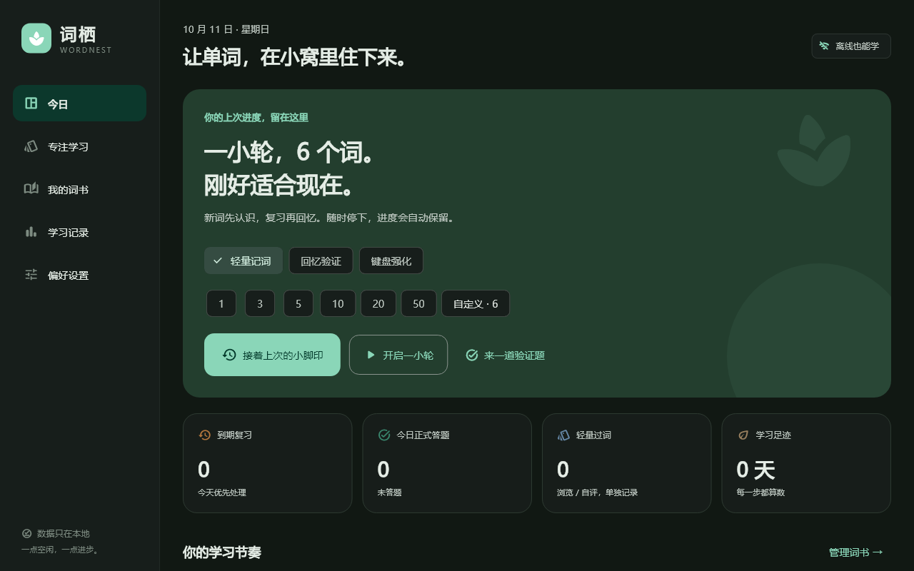
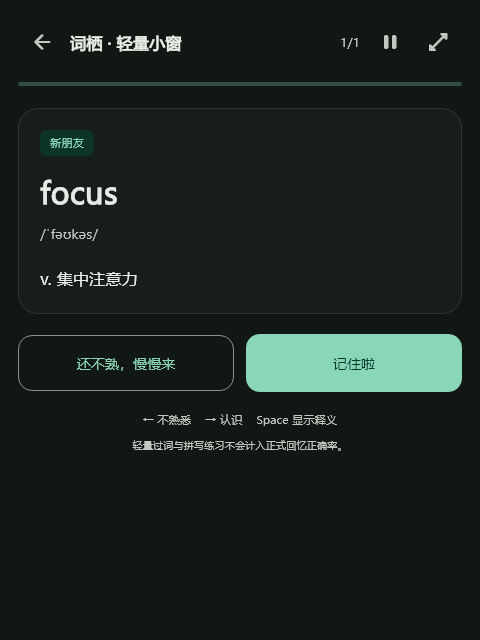

# 词栖 WordNest

给单词，一点栖息的时间。Flutter 开发的 Windows / Android 本地记词工具。

## 功能

- 轻量记词、英文选中文回忆验证、键盘强化，首页和测试页快速选择每轮数量。
- 原书、逆序、字母、随机、薄弱词及词族顺序。不限每日新词、答题或提醒次数；提醒保留间隔和时段。
- 回忆验证左右键回看，结果与选项保存，回看不重复计分。
- 自动朗读可选，离线词缀联想提示，个人笔记；简洁 / 可爱文案切换。
- Windows 托盘右键菜单、小窗、主题与配置快捷键。
- Android 用户确认日历日程入口；复杂厂商推送、后台必达仍延期。
- 可配置可信公开 JSON 版本源，手动 / 每日自动检查，不自动执行安装包。

## 界面预览

以下为应用组件实际 Flutter 渲染的演示预览，不是原生系统通知或手机验收截图；内容为自编词书，没有用户笔记或学习成绩。






## 词书与本地数据

公开源码默认使用自编演示书，并包含 MIT 许可 ECDICT 常用词典子集。支持 JSON、TXT、CSV 导入，完整 JSON 备份保留学习进度；不需要账号，没有云同步。

个人构建中的第三方四级资料未确认公开再分发许可，因此不复制到本公开源码。原始资料见 [Jimmy-Grammar 上游词书](https://github.com/Jimmy-Library/Jimmy-Grammar/blob/main/wordbooks/大学/四级/386871_英语四级你还在背单词吗？.json)，可自行核实权利与内容后导入。来源可访问不等于获得出版社音频或公开分发授权。

## 构建

Flutter 3.47.7 / Dart 3.13.5。Windows 需要 Visual Studio C++、SDK、ATL 和 NuGet；Android 使用 JDK17/SDK36。

```sh
flutter pub get
flutter analyze
flutter test --concurrency=1
flutter build windows --release
flutter build apk --release
```

Android 当前 release 使用 Debug 测试签名，不适合商店发行；Windows未代码签名。厂商省电、Doze、强停和通知显示不是应用能保证的行为。

## 快捷键

正式：1–4 选择，Enter 下一题，左右键回看。轻量：左右键自评，Alt+左右键回看。拼写：Enter 检查，Tab 跳过，Esc 提示，Ctrl+P 发音。

## 更新源格式

分别按平台提供 `{ "version": "0.2.1", "platform": "windows", "downloadUrl": "https://.../app.exe" }`。源必须是可信公开地址，应用拒绝本机/私有/保留目标及不安全重定向。示例文件是模板，不代表真实新版本已发布。

依赖与资源许可见 assets/ECDICT-LICENSE.txt 和应用开源许可。当前没有声明整个项目的开源许可证；公开可查看不等于授予额外复制授权。
